# 🍯 Cloud Honeypot: Capturing Live Attacks with T-Pot


A **honeypot** is a decoy system built to attract attackers so defenders can study their tools and behavior safely. I deployed **[T-Pot](https://github.com/telekom-security/tpotce)**, an all-in-one multi-honeypot platform, on a public **Vultr** cloud server, exposed it to the internet, and analyzed real-world attack traffic with **Kibana, the Attack Map, CyberChef, and SpiderFoot**.

## 🎯 Objectives

- Deploy and harden a cloud server, then intentionally expose honeypot services
- Capture real attacker activity: source IPs, countries, targeted services, credentials tried
- Practice threat analysis and threat intelligence with the ELK stack and OSINT tools

## 🏗️ Deployment

### 1. Provision the cloud server (Vultr)
I chose **Cloud Compute (Shared CPU)**, a nearby region, **Ubuntu**, and a plan with a **160 GB SSD** to give the honeypot logs room to grow.

| Compute type | Location | OS |
|---|---|---|
| 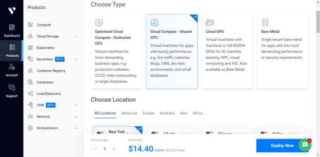 | 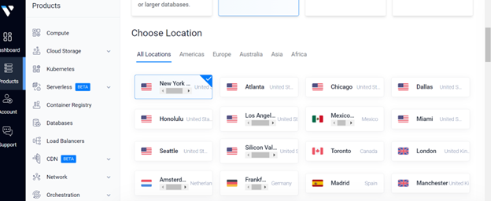 | 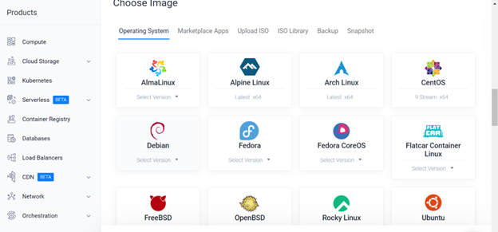 |

| Plan | Name & deploy | Running |
|---|---|---|
| 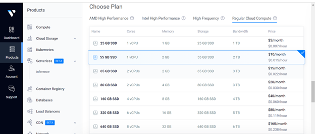 | 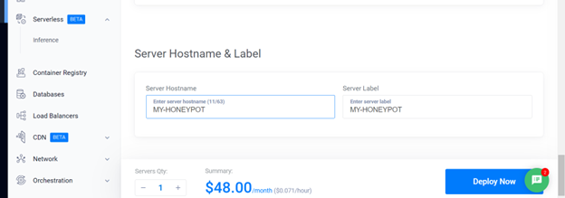 | 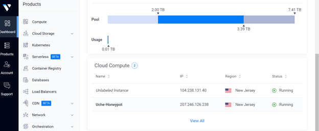 |

### 2. Configure the cloud firewall
I created a Vultr firewall group and attached custom inbound rules to the server to control which traffic reaches the honeypot and its management ports.

| Firewall group | Rules |
|---|---|
| 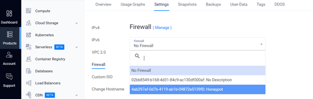 | 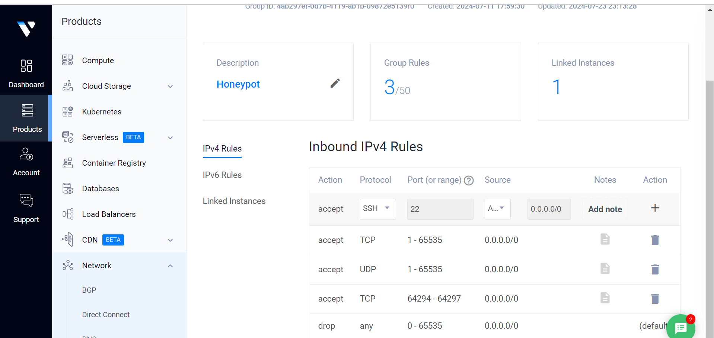 |

### 3. Install T-Pot
```bash
sudo apt update && sudo apt upgrade -y
sudo apt install -y git curl
git clone https://github.com/telekom-security/tpotce
cd tpotce
./install.sh        # run as a non-root sudo user
sudo reboot
```

> ⚠️ **What the installer changes:** it moves SSH to **tcp/64295**, disables the DNS stub listener, installs Docker, sets the public firewall zone to `ACCEPT`, and registers `tpot.service` so all honeypot containers start on boot.

After the reboot, I logged into the T-Pot web UI over HTTPS (port `64297`) with the admin credentials I created during install.

## 📊 Analysis & Findings

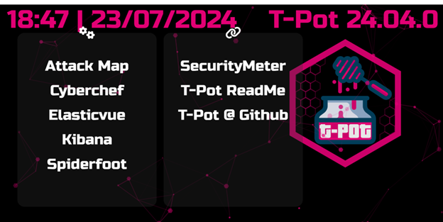

| Tool | What I Used It For |
|---|---|
| 🌍 **Attack Map** | Watched attacks arrive in real time: origin country, targeted honeypot, top hitters |
| 📈 **Kibana** | Built dashboards of attack counts, source IPs, targeted ports, and honeypot activity, and practiced Discover queries |
| 🧪 **CyberChef** | Decoded and analyzed attacker payloads and encoded strings |
| 🗄️ **Elasticvue** | Inspected the Elasticsearch indices behind the dashboards |
| 🕵️ **SpiderFoot** | Ran OSINT reconnaissance on attacker IPs and domains |

| Attack Map | Kibana Dashboard |
|---|---|
| 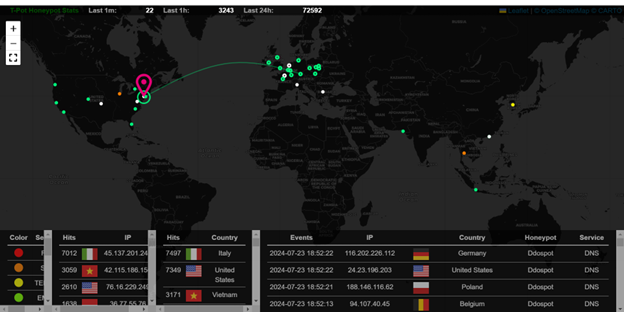 | 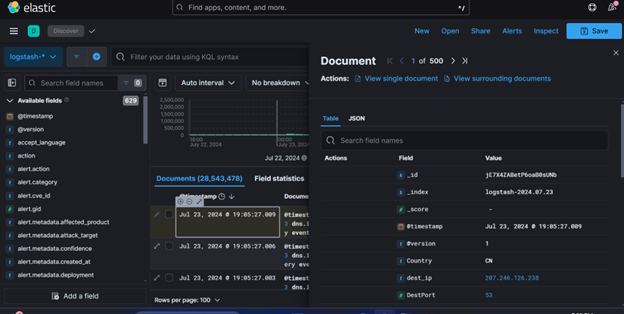 |

| Kibana | Kibana Discover |
|---|---|
| 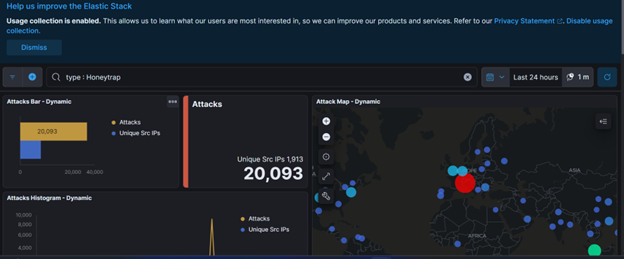 | 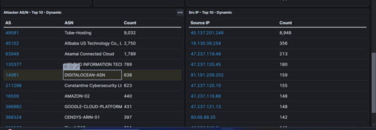 |

| CyberChef | SpiderFoot |
|---|---|
| 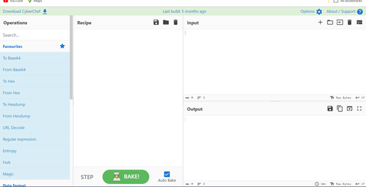 | 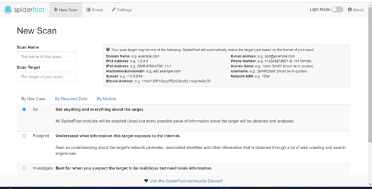 |

## 📚 Key Takeaways

- Saw first-hand how quickly an internet-facing service attracts automated scanning and attacks
- Gained hands-on experience with **cloud provisioning, firewall design, Docker-based services, and the ELK stack**
- Practiced turning raw attack telemetry into **threat intelligence**: who is attacking, from where, and how
- Learned to run deliberately exposed infrastructure safely, keeping the honeypot isolated on its own cloud server
